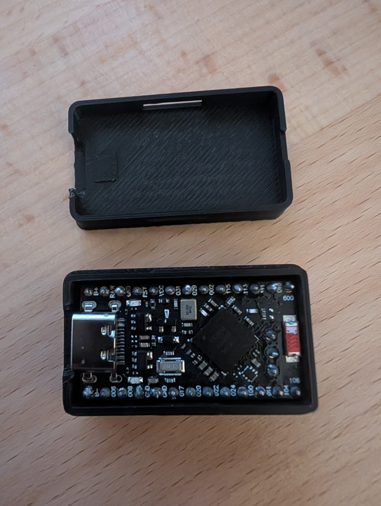
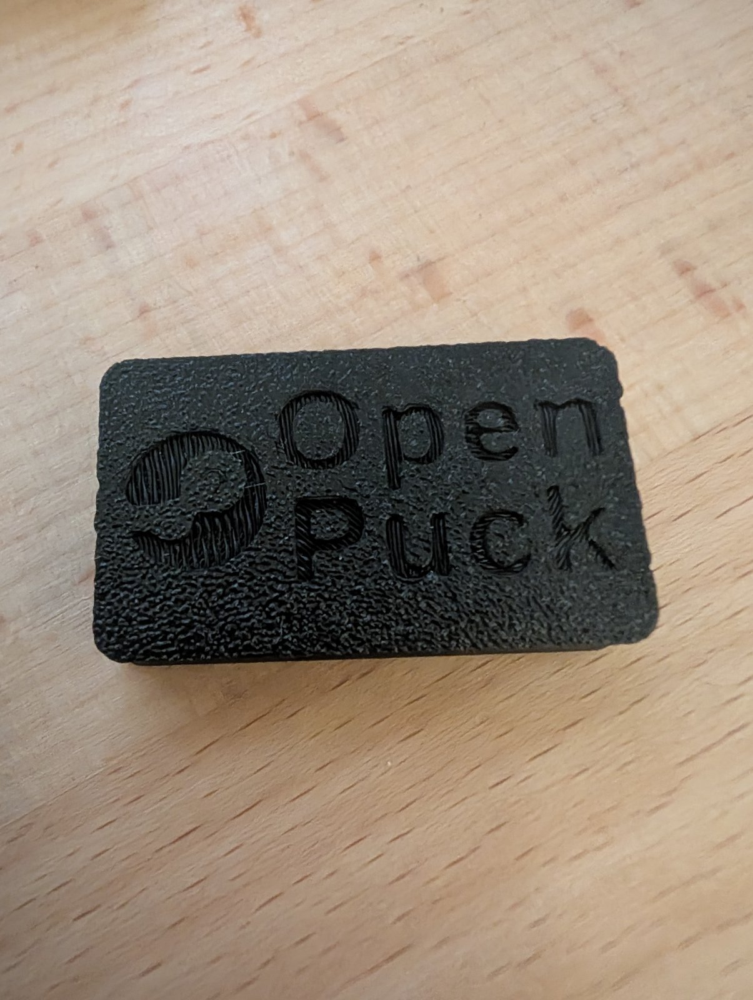
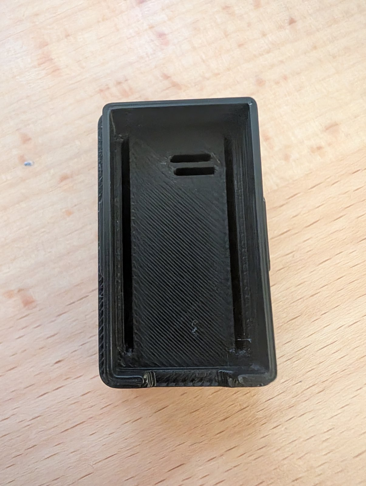

# nRF52840 Pro Micro Case ("OpenPuck")

Two-part snap-fit case for a **Pro Micro nRF52840** board (nice!nano v2 compatible / SuperMini clones) with **all headers soldered**: both long rows plus the 3 extra pins (P1.01 / P1.02 / P1.07) at the end of the board.
The header plastic sits under the board and the long pins point down (breadboard orientation). The case encloses everything and keeps the USB-C port reachable.

It was made for [OpenPuck](https://github.com/safijari/openpuck): open-source firmware that turns this board into a replacement for the Steam Controller 2's wireless "puck" receiver. The Pro Micro nRF52840 is the default hardware for it. The case fits any Pro Micro nRF52840 with headers, whatever firmware it runs.

It was measured with calipers, test-printed and refined over several prints.
It was designed with help from Claude (Anthropic's AI assistant) in Claude Code.

**Printables:** https://www.printables.com/model/1897347
**GitHub (source):** https://github.com/gira0/3d-prints/tree/main/nrf52840-case

| | |
|---|---|
|  |  |

## Files

| File | Purpose |
|---|---|
| `nrf52840_case.scad` | The OpenSCAD model. All settings are at the top of the file. |
| `stl/base.stl` | Base with a side window for bridging RST and GND with tweezers |
| `stl/base_rst_bottom.stl` | Base with a slot in the floor instead (for a bent paper clip) |
| `stl/base_rst_none.stl` | Closed base |
| `stl/lid.stl` | Lid with the "Open / Puck" engraving |
| `preview/` | Renders of the model |
| `printables/` | Listing text (`DESCRIPTION.md`) and render images for printables.com |
| `docs/research-report.md` | Board dimensions, pin coordinates, clearances, and as-built measurements |
| `docs/research_notes/` | The research notes behind the report, with sources |

The STLs are generated for the measured board below. If your board differs, change the values in the `.scad` file and export again.

## How it works

- **Base:** the header plastic rests on a raised floor, and the long pins drop into slots. The slots end just past the first and last pin, so the board can't slide when you plug in or pull out a cable.
- **Lid:** a skirt slides over a 1 mm rim on the base and clicks onto a bump on each long side. The click pulls the lid down tight, so it doesn't rattle. To open it, pry at the notch at the end opposite the USB port.
- **Reset:** these boards have no reset button. You reset by bridging RST and GND, and double-tap for the bootloader. `rst_access` gives you a side window, a floor slot, or no opening.

## Measure your board first

Clones differ. The as-built board had **13 pins per row** (the header also goes through the B−/B+ holes) and a **raised USB-C socket**: it sits in the usual cut-out in the PCB, but higher than the centred mid-mount socket on the official nice!nano (top 4.0 mm above the PCB underside instead of about 3.2). Enter these values in the `[Board: MEASURE these]` block:

| Setting | What to measure | As built |
|---|---|---|
| `pcb_t` | Bare PCB thickness | 1.6 |
| `hdr_plastic` | Height of the black header plastic | 2.5 |
| `hdr_long` | Long pin length below the plastic | 6.0 |
| `tail_above` | Tallest solder joint above the PCB top | 2.0 |
| `usb_top` | USB-C shell top above the PCB underside | 4.0 |
| `pcb_l` / `pcb_w` | Board length and width | 32.9 / 17.78 |
| `row_pins` | Pins per long row (12 or 13) | 13 |
| `variant` | Position of the 3 extra pins: `nicenano`, `supermini` or `both` | both |
| `plug_w` / `plug_h` | Your cable's plug body + 0.4 mm | 11.0 / 6.0 |

Outside size with these values: **38.75 × 22.88 × 16.8 mm**.

## Printing

Tested on an Anycubic Kobra S1 with a 0.4 mm nozzle, 0.2 mm layers and PLA+.

- **Orientation:** print the base upright and the lid upside down (roof on the plate). No supports are needed.
- **Walls:** use Arachne (variable-width walls) and 3–4 wall loops.
- **Lid first layer:** the engraving is printed against the plate.
  - Set elephant-foot compensation to about 0.1 mm.
  - Set the first-layer line width to about 0.42. Wider first-layer lines fill the letters.
  - A smooth plate gives sharper letters than textured PEI.
- **Fit tuning:** if the pins drag, raise `pin_slot` to 1.3. If the lid is too hard to close, lower `snap_preload` to 0.1. If it rattles, raise it to 0.25.

## Engraving and logo

The lid has a logo and a two-line label. Change `label`, `label_size` and `logo_d` in the `[Engraving on lid top]` block.

`logo` options:
- `"simple"` (default): a bold simplified mark drawn in OpenSCAD. All its parts are at least 1 mm wide, so it prints cleanly with a 0.4 mm nozzle.
- `"none"`: text only.
- `"svg"`: any one-colour SVG file. It is not included in this repo.

To use the Steam icon as the SVG:

1. Download the one-colour Steam icon from Font Awesome (free, CC BY 4.0): [steam.svg](https://raw.githubusercontent.com/FortAwesome/Font-Awesome/6.x/svgs/brands/steam.svg)
2. Save it as `assets/steam.svg` next to the `.scad` file.
3. Set `logo = "svg"`. `logo_file` already points to `assets/steam.svg`.

Multi-colour SVGs with gradients import as a plain disc, so use a one-colour icon. Steam is a trademark of Valve Corporation; this project is not affiliated with Valve.

## License

[CC BY-SA 4.0](../LICENSE). You may share and adapt it, including commercially, with attribution and under the same license.
